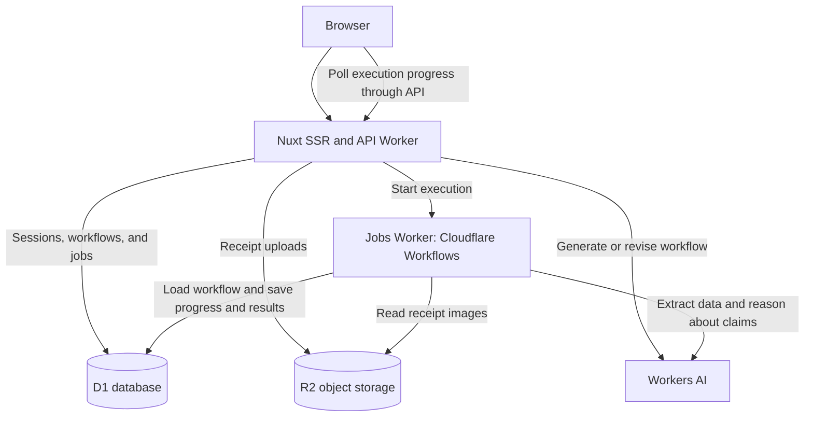

# Automated Claim Adjudication Demo

Welcome to my AI-powered application.

[https://demo-web-production.talham7391.workers.dev](https://demo-web-production.talham7391.workers.dev)

* ✅ LLM (Using Llama 4)
* ✅ Workflow / coordination (You author a multi-step workflow where the output of one LLM feeds into the input of the next LLM)
* ✅ User input via chat (You describe the workflow you'd like and the system generates it for you)
* ✅ Memory or state (Workflow outputs are saved and fed as inputs into the LLM)

Note - This project was developed in a limited 48-hour window.

[Watch a demo on YouTube](https://youtu.be/n4MSGxmc0RM)

### Motiviation / Problem

I worked in the group benefits space for the past 5 years, where our primary product was an HSA (health spending account). We had hundreds of thousands of incoming claims and a dedicated claims team that was responsible for adjudication.

Claim ajduication is a complicated multi-step workflow, and here are examples of the types of decisions that need to be made:
- Does the member have enough funds under their current plan design to pay for the claim?
- Is the claim within the current benefit period for the member?
- Is the claim fabriacated? (i.e. is the member attempting to commit fraud)
- etc...

It was a bottleneck for our business, but this process can be automated using AI.

### Solution

I've built an app that allows people to craft automated workflows with configurable steps. Each step may have outputs that feed as inputs into the next step.

You type your desired adjudication workflow, with the following building blocks available to you:
- Extract information out of an image
- Ask AI to reason or make a judgement given the inputs
- Make an API call to bring in data from an external system (just a mock for now)

## Disclaimer

### Don't use sensitive information

Use synthetic receipts and fictional policy information only. This demo has no user authentication or access controls tied to a verified identity. Anyone with a session URL can access that session's saved workflow and execution data. Treat anything submitted as exposed to anyone who obtains the URL.

Uploaded images and execution data are stored in Cloudflare R2 and D1, and relevant text and images are sent to Workers AI for inference. The application has not undergone a security review and does not include rate limiting or production privacy safeguards. Do not submit personal, medical, financial, or other confidential information.

### Heavy use of AI

This project was vibe-coded with extensive AI assistance within a short development window. The code needs further review and cleanup before any production use.

AI also generates workflows, extracts receipt data, and reasons about claims at runtime. These outputs can be incomplete or incorrect, even when they match the expected data structure. Treat the results as demonstrations, not authoritative coverage or payment decisions.

## Architecture

The application runs on Cloudflare, with separate Workers for the web application and background execution.

- **Web Worker:** Serves the Nuxt application with server-side rendering and API routes for sessions, workflow edits, uploads, and execution history.
- **Jobs Worker:** Runs saved workflows through Cloudflare Workflows. Each step executes in order, with progress persisted independently of the browser.
- **D1:** Stores sessions, workflow definitions, execution inputs, step progress, and final results. Each job keeps a snapshot of the workflow it executes.
- **R2:** Stores uploaded receipt images for background processing.
- **Workers AI:** Provides inference for workflow authoring, image extraction, and reasoning.

### How the agents work

The two agents are model calls with different responsibilities and instruction files:

1. **Workflow authoring agent:** Receives the existing workflow and the user's requested changes. The [workflow authoring guide](agents/how_to_understand_workflows.md) instructs it to produce a structured workflow with inputs, ordered steps, and outputs. The server checks the returned schema before saving it.
2. **Execution agent:** Runs extraction and reasoning steps using the saved workflow's instructions, declared outputs, and inputs from earlier steps. Calls containing images use the [image extraction guide](agents/how_to_extract_data_from_images.md); other calls use the [reasoning guide](agents/how_to_reason.md). The worker checks returned fields and types before persisting them. Invalid AI output stops the job with a `needs_review` status.

Workflow execution is controlled by application code. Steps labeled `api` currently use configured mock JSON responses rather than calling external services. A `needs_review` status can be inspected, but manual resolution is not implemented.

## Future Work

The project was built within a 48-hour window, and time ran out before the following improvements could be completed:

- **Clean up the AI-generated code:** Simplify rough implementations, improve consistency, and review the overall design.
- **Develop more capable agentic workflows:** Spend more time on planning, tool use, and recovery behavior. The current token budget limits how far this can be explored.
- **Add security measures:** Introduce authentication, session access controls, rate limiting, and appropriate protections for uploaded data.
- **Improve AI inference reliability:** Route inference to a second model when the primary model fails, and experiment with different skill and instruction files to improve extraction and reasoning.
